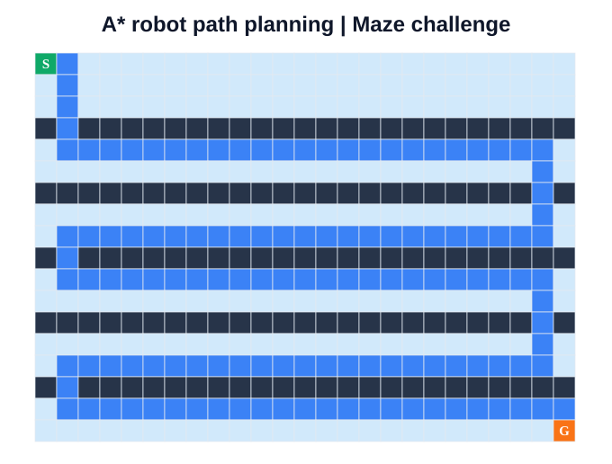

# 🤖 Robot Route Lab — A* Path Planning Simulator

An interactive Python robotics portfolio project: navigate a grid with **A\*** and **Dijkstra**, visualize explored cells and the optimal path, compare the algorithms, and export route coordinates.

**🚀 [Launch the live Robot Route Lab simulator](https://robot-path-planning-simulator-l3b26kllrcac7kk3jskbal.streamlit.app/)** — no installation required.



## Features
- Interactive **Streamlit** interface and five obstacle scenarios (maze, warehouse, random, clear floor, blocked passage).
- Original Python implementations of **A*** and **Dijkstra**, using the `heapq` priority queue and Manhattan-distance heuristic.
- A search-progress slider, performance comparison, start/goal coordinates, route CSV export, and seeded reproducible maps.
- Command-line demonstration, **14 unit tests**, and GitHub Actions CI on Python 3.10 and 3.12.

**Movement model:** Four directions and unit edge cost. On this model, Manhattan-distance A* finds an optimal route when one exists. This educational simulator does not model sensors, motor dynamics, robot dimensions or turning radius.

## Run locally
Requires Python 3.10+.

```bash
git clone https://github.com/jaypatelrob/robot-path-planning-simulator.git
cd robot-path-planning-simulator
python3 -m venv .venv
source .venv/bin/activate
python -m pip install -r requirements.txt
python -m streamlit run app.py
```

## Command line and tests
```bash
python3 -m robot_path_planner.cli
python3 -m robot_path_planner.cli --algorithm dijkstra --scenario 'Blocked passage'
python3 -m unittest discover -s tests -v
```

CLI legend: S = start, G = goal, # = obstacle, * = final route.

## How it works
**A\*** chooses the next node using `f(n) = g(n) + h(n)`, where g(n) is known distance from the start and h(n) is Manhattan distance to the goal. **Dijkstra** uses `f(n) = g(n)` and ignores the heuristic. Both find shortest routes; they may explore different numbers of nodes.

Read the [algorithm walkthrough](docs/ALGORITHM.md) and the [unit tests](tests/test_planner.py).

## Deploy
**Live deployment:** [Open Robot Route Lab](https://robot-path-planning-simulator-l3b26kllrcac7kk3jskbal.streamlit.app/). Hosted publicly on Streamlit Community Cloud from this GitHub repository, branch `main`, entrypoint `app.py`.

## Inspiration and attribution
Learned path-planning concepts and visualization ideas from [PythonRobotics](https://atsushisakai.github.io/PythonRobotics/) by Atsushi Sakai and contributors. This is a separately written educational implementation, not copied PythonRobotics source.

**AI assistance:** The initial application, algorithms, tests, and documentation were developed with ChatGPT assistance. The maintainer should study the code, verify functionality, and accurately describe their own contribution in interviews.

MIT licensed.
